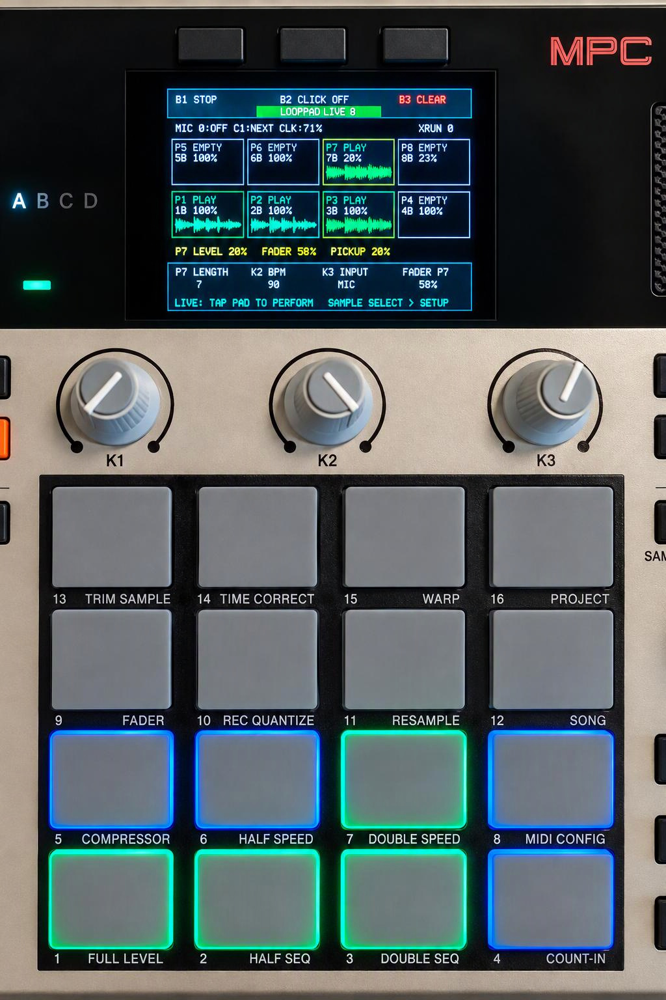
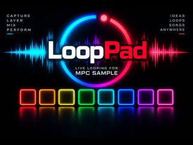

# LoopPad

**LoopPad** is an experimental open-source fixed-length live looper for the **Akai MPC Sample**.

LoopPad runs directly on the MPC Sample and turns the hardware into a pad-driven live looping instrument using the built-in display, RGB pads, microphone/rear inputs, knobs, fader, and hardware level meters.

<p align="center">
  
</p>

<p align="center">
  <em>LoopPad v0.6.1-alpha running synchronized loops on MPC Sample hardware.</em>
</p>

> **Status:** Alpha-quality community software. The current development release is **v0.6.1-alpha**.

## What LoopPad does

LoopPad is designed around a simple workflow:

1. Configure loop slots in **SETUP** mode.
2. Choose an independent length of **1 to 8 bars** for each pad.
3. Switch to **LIVE** mode.
4. Arm a pad and record from the built-in microphone or rear input.
5. LoopPad records the configured length and immediately plays it back in sync.
6. Mix, stop, restart, clear, and combine independent loops from the MPC hardware.

## Current features

- Fixed-length synchronized live looping
- Detailed **4-loop** mode
- Compact **8-loop** mode
- Independent **1–8 bar** length per loop pad
- **SETUP / LIVE** workflow
- Built-in microphone and rear-input routing
- **NEXT / 1BAR / NOW** recording count-in modes
- **BAR / BEAT / OFF** start/stop quantization
- Phase-locked loops that retain their master-clock position while stopped
- Per-loop playback level using the MPC fader
- Soft takeover / pickup for per-loop level changes
- Independent master volume and metronome level
- Metronome on/off
- Waveform display for recorded loops
- Moving waveform playhead
- Hardware RGB pad state feedback
- MPC side LEDs used as live L/R input meters
- Clear confirmation to reduce accidental loop deletion
- Startup mute/fade to avoid output transients
- Embedded LoopPad splash screen

## Loop states

| State | Typical indication |
|---|---|
| Empty | Dim / selected cyan in SETUP |
| Armed / count-in | Flashing amber |
| Recording | Red |
| Playing | Green |
| Stopped | Blue |
| Queued start/stop | Blue/green variants |

## Controls

| MPC control | LoopPad function |
|---|---|
| Pads 1–4 / 1–8 | Loop slots |
| B1 | Global transport |
| B2 | Metronome on/off |
| B3 | Clear selected loop with confirmation; cancel arm when armed |
| K1 | Selected pad loop length in SETUP |
| Shift + K1 | Metronome volume |
| K2 | BPM |
| Shift + K2 | Quantize: BAR / BEAT / OFF |
| K3 | MIC / REAR input |
| Shift + K3 | Count-in: NEXT / 1BAR / NOW |
| Fader | Selected loop playback level |
| Sample Select | SETUP / LIVE mode |
| Pad Bank | Switch 4-loop / 8-loop layout in SETUP |

## 4-loop and 8-loop modes

LoopPad uses an eight-clip engine underneath two views.

### 4 LOOP

- Pads 1–4 active
- Larger 2×2 clip panels
- Larger waveforms and more detailed feedback

### 8 LOOP

- Pads 1–8 active
- Compact 2×4 clip overview
- P5–P8 appear on the upper display row
- P1–P4 appear on the lower display row, matching the physical pad arrangement
- Pads 9–16 are reserved for future performance functions

Switching from 4 to 8 loops is allowed in SETUP.

Switching from 8 back to 4 is blocked while Pads 5–8 contain loops, preventing active loops from becoming hidden.

## Audio platform

The current MPC Sample test hardware exposes the internal audio interface through ALSA card 2 / device 0.

LoopPad currently uses:

- 44.1 kHz
- Stereo
- Signed 32-bit little-endian PCM (`S32_LE`)
- 128-frame audio periods
- TinyALSA for capture/playback and mixer control

Input routing discovered during development:

- **MIC:** Builtin Microphone Switch = 1, TRS Switch = 0
- **REAR:** Builtin Microphone Switch = 0, TRS Switch = 1

## Build dependencies

LoopPad is written in C and cross-compiled for the MPC Sample's AArch64 Linux environment.

Current development uses:

- [Zig](https://ziglang.org/) as the cross-compiler
- [TinyALSA](https://github.com/tinyalsa/tinyalsa) for audio I/O
- [mpc-ui-toolkit](https://github.com/garrettjwilke/mpc-ui-toolkit) for the MPC Sample display, pads, controls, LEDs, input handling, widgets, and application framework
- [mpc-boot-thingy](https://github.com/garrettjwilke/mpc-boot-thingy) to install and launch alternative MPC Sample applications
- Python 3 to generate the embedded splash-screen header

See [BUILDING.md](BUILDING.md) for the reproducible build procedure.

### Tested toolkit revision

LoopPad v0.6.1-alpha has been tested against:

```text
mpc-ui-toolkit
0c162ff88940445c6c9977fd60d99fac9192eb7b
```

## Installation

### Recommended: MPC Boot Thingy

The currently supported way to install and launch LoopPad is **MPC Boot Thingy**.

1. Install MPC Boot Thingy on the MPC Sample.
2. Connect the MPC Sample to the computer over USB.
3. Open `http://192.168.155.1:8080`.
4. Choose **Install App**.
5. Select the LoopPad AArch64 binary.
6. Leave **Args** blank.
7. Keep **Stock** as the default boot application.
8. Launch LoopPad manually with **Boot now**.

> **Important: no standalone exit / power-off yet**
>
> LoopPad currently has **no implemented hardware exit or power-off function of its own**.
>
> MPC Boot Thingy is therefore currently required for the supported recovery/reboot workflow.
>
> **Do not configure LoopPad as the default boot application. Keep Stock as Default.**

A clean in-app exit/shutdown path is planned before a stable v1.0 release.

## Current development status

LoopPad v0.6.1-alpha has been hardware-tested with:

- 4-loop detailed mode
- 8-loop compact mode
- Eight simultaneous loops
- Mixed loop lengths
- BAR / BEAT / OFF quantization
- Phase-locked stop/start
- Per-loop levels
- Waveform display
- Hardware VU meters
- Startup mute/fade
- Embedded splash screen
- Updated MPC pad LED handling
- **XRUN 0** during the current eight-loop stress test

## Screenshots

### Startup splash

<p align="center">
  
</p>

The splash screen is embedded directly in the LoopPad binary. The application version is rendered separately at runtime, allowing the same artwork to be reused across future releases.

## Roadmap

### High priority

- Unified Settings UI
- Overdub existing loops without consuming another pad
- Physical Undo with memory-safe Undo history
- Save/load complete LoopPad sessions from SD card
- Solo and mute workflow
- Clean Exit / Shutdown / recovery path

### Performance controls

Pads 9–16 may later be used for:

- Stop All
- Play All
- Solo / Mute modes
- Scenes
- Performance FX
- Clear mode
- Overdub mode

### Future ideas

- MIDI clock synchronization
- USB audio input
- Adjustable loop-boundary fade/crossfade
- Reverse playback
- Half-speed playback
- Session/project management
- Export recorded material for continued work in Stock MPC

## Development documentation

Detailed development notes are maintained in the [docs](docs/) directory.

## Safety and disclaimer

LoopPad is an unofficial community project. It is **not affiliated with, sponsored by, or endorsed by Akai Professional**.

Before testing:

- Back up the SD card and important MPC projects.
- Keep Stock as the default boot application.
- Do not distribute private SSH keys or personalized autorun data.
- Use experimental builds at your own risk.

## Author

LoopPad was created by **Lars Öholm** ([github.com/larsoholm](https://github.com/larsoholm)).

Contributions are welcome through GitHub issues and pull requests.

## License

LoopPad's original source code is licensed under the **MIT License**.

Copyright (c) 2026 Lars Öholm.

See [LICENSE](LICENSE) for the full terms.

LoopPad uses third-party components with separate license terms. See [THIRD_PARTY_NOTICES.md](THIRD_PARTY_NOTICES.md) for details.

### Binary releases

LoopPad may be distributed as a precompiled AArch64 binary for the MPC Sample.

`mpc-ui-toolkit` is released under **CC0 1.0 Universal**. TinyALSA is distributed under its own permissive redistribution terms.

Required third-party notices are documented in [THIRD_PARTY_NOTICES.md](THIRD_PARTY_NOTICES.md).

## Acknowledgements

LoopPad builds on community work around the MPC Sample, particularly:

- [mpc-ui-toolkit](https://github.com/garrettjwilke/mpc-ui-toolkit)
- [mpc-boot-thingy](https://github.com/garrettjwilke/mpc-boot-thingy)
- [TinyALSA](https://github.com/tinyalsa/tinyalsa)

Thanks to Garrett Wilke and the wider MPC Sample community for documenting and exploring the platform.
